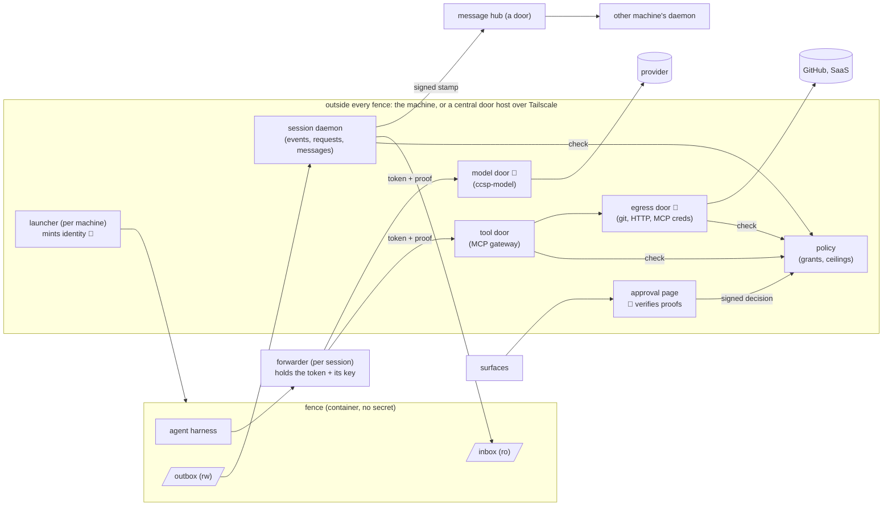

[Index](README.md) › Unified model › 1. Security contract

**Docs:** **1 · contract** · [2 · tiers](cc-unified-model-tiers.md) · [3 · CC Flow as a client](cc-unified-model-cc-flow.md) · [4 · working log](cc-unified-model-log.md) · [5 · build plan](cc-unified-model-build-plan.md)

# Security contract

**In one line.** An agent session runs inside a **fence** that holds no secret. It reaches
the world only through **doors** on the host. Every door learns the session's identity from
outside the fence, never from text the agent wrote, and checks it against **grants**. Only a
human with a proof that an agent can't make can widen a grant.

This doc names no orchestrator. Whatever starts sessions (a script, CC Flow, a CI job) is a
client of the contract. [Doc 2](cc-unified-model-tiers.md) says which components each tier adds.

## 1. Threats

The four threats, with the controls that stop each one, the tier where each control first
appears, and the risk that's left.

### T1 · Provider leak

An LLM provider that stores conversations gets breached. Any credential that ever appeared
in a conversation leaks with it.

- **Controls.**
  - No secret inside the fence: the agent can't paste what it doesn't have.
  - The **model door** injects the real credential outside the fence. The fence holds only a placeholder.
  - The **secrets proxy (ccsp)** in the model door redacts known and rule-based secrets in
    everything sent to the provider, including secrets the agent reads from worktree files (a
    stray `.env`).
- **From:** solo.
- **Left:** anything that can't be detected by rule or isn't known in advance gets through:
  unknown secret formats, customer data, plain sensitive text.

### T2 · Compromised code

A library, an MCP server or any other downloaded code does more than it claims.

- **Controls.**
  - **The fence.** Code runs in a container with no secret, no host home directory, only its
    worktree, and no network except the doors.
  - **The egress door.** Only listed routes leave. The upstream credential is injected at the
    door, so neither the code nor the MCP server ever sees it.
  - **The tool door** (friends tier). MCP servers come from a catalog fixed at session start, and
    each tool description is hash-pinned on registration, so a server that changes its tools gets
    blocked. A stdio server runs in its own container.
  - **The host commits and pushes.** The git route checks paths and refuses force-pushes.
  - **Poisoned worktree.** The host runs its git commands with worktree hooks disabled. Files
    the agent wrote that steer tools or agents (git hooks, `CLAUDE.md`, harness settings,
    config) are untrusted input for the next session. No unfenced session or host tool loads
    them without review, and a change to any of them is flagged in the commit.
- **From:** solo (fence, egress door, git route, hooks off); friends (catalog and pinning).
- **Left.** For libraries the fence is the **only** control: nothing scans or pins dependencies
  inside the worktree. Bad code can use every grant the session holds and write anything into
  the worktree, and that goes into commits the host pushes. Containers share the host kernel
  (§9), so a container escape means the host.

### T3 · Over-eager agent

An agent keen to finish a task does something it can't undo.

- **Controls.** The existing **allow / ask / forbid** tiers, with no new component:
  - "Irreversible" pushes an action into **ask** or **forbid**. The user labels which tools and
    resources are irreversible (sending email, deleting, a production database).
  - The git route forbids force-pushes and pushes to protected branches by default.
  - The worktree is disposable, and grants expire with the session.
- **From:** solo (git rules, disposable worktree); friends (ask tier with passkey approval).
- **Left:** damage inside a granted scope that the user didn't label as irreversible.

### T4 · Prompt injection

Untrusted text, such as a web page, an issue, a tool result or another agent's message, steers the agent.

- **Controls.**
  - **Authority never travels as text.** An injected agent can only use its own grants. No
    message can approve anything.
  - **The lethal-trifecta rule.** No session holds private data, untrusted input and an outbound
    channel all at once. The grant plan (§6) is where one of the three gets dropped.
  - **Outbound scanning** at the egress door and the tool door, using the same scanner as ccsp.
  - **Size and rate caps, plus an audit log** of every door decision.
  - **Sender stamps** on agent-to-agent messages (§7).
- **What an injected agent can reach:**
  - **Solo:** its worktree, the model, and the egress routes configured for its session (for
    example, pushing to its own branch).
  - **Friends:** the same, plus the MCP tools its grants allow. Anything else becomes an ask for a human.
  - **Company:** the same, plus delegated documents, never beyond the human's own access (§8).
- **Left.** Any allowed write channel can still leak. Only fixed rate caps exist: nothing
  detects unusual volume or alerts on it, and nobody watches the audit log yet. Taint tracking
  isn't designed (§9).

## 2. Terms

- **Session.** One agent run, with an identity that exists before its process starts.
- **Generation.** A restart of the same logical session, which gets a new identity. Grants die with their generation.
- **Owner.** The human the session works for. A session never exceeds its owner's access.
- **Fence.** The container the agent runs in: no secret, one worktree, network only to the doors.
- **Door.** A process outside every fence that carries one kind of traffic out and enforces policy on it.
  It runs on the session's machine or on a central door host reached over a private network.
- **Machine.** A computer that runs fences. One owner can have several.
- **Cockpit.** The client that shows sessions and steers them (CC Flow, for Tom). It can run on
  any of the owner's machines. It's for visibility and steering only: no session needs it to work (invariant 28).
- **Grant.** A permission for one session or profile, which expires at the enforcer.
- **Ceiling.** The most a session may ever be granted without a new decision.
- **Proof.** A signature only the human can make (a passkey, or an OTP for medium risk).
- **Surface.** Anything that shows requests to the human: a web page, a phone, Telegram, an orchestrator.
- **Unfenced session.** An agent running directly on the host. It is outside this contract (§5, invariant 13).

## 3. Picture

## 4. Session identity and doors

**Identity** = `owner / machine / session-id / generation`, plus an optional free-text `label`
that the client chooses (CC Flow puts its tree address there). The launcher on each machine
creates the identity before any process starts and signs a **session token** with that
machine's key. Doors trust a list of machine keys, so a central door can tell sessions apart
even when they all arrive from the same machine address. Each door gets the identity from
outside the fence:

| Door | Gets identity from | Holds |
|---|---|---|
| Model door | session token | model credentials 🔑 |
| Tool door | session token (`aud`, `exp`, `gen`) | nothing that works outside |
| Egress door | session token | upstream credentials 🔑 |
| Session daemon | **which outbox** the file landed in | nothing (signing goes through a separate signer) |
| Message hub (a door, v2.3) | the principal's own hub credential, plus the sender's signed stamp | nothing that works outside |

**The token never enters the fence** (v2.3). A per-session forwarder outside the fence (a
container next to it, or the pod's sidecar) holds the token and a per-generation key whose public
half is in the token. Every door call carries a proof made with that key, so a copied token is
useless. The same key signs the session's message stamps, with a separate domain prefix.

The source IP is logged but not trusted, because container IPs get reused after exit and every
session on a machine shares one address on the private network.

**Billing.** The model door can hold more than one credential (for example a subscription
login and an API key). The launcher picks one per session and records it (invariant 18).
**Subscription** (v2.4): the door holds the owner's one-year token from `claude setup-token`
(static, so no refresh-token custody) and injects it as the bearer credential, with the OAuth
capability header, for sessions billed `subscription`. The fence holds only a dummy credential.
This works from the first slice (doc 5 U4, R5b).

## 5. Invariants

1. **Identity exists before the process** and is stamped from outside: from the container, the
   outbox or the token, never from a request body or message text.
2. **No secret inside the fence.** That covers upstream credentials, OAuth tokens, static
   bearers, signing keys and the host's agent config. The host home is never mounted.
3. **Enforcement is outside the fence.** In-fence hooks and deny lists are speed bumps only.
4. **One way out per channel:** the model through the model door, tools through the tool door,
   git and HTTP through the egress door, requests through the session daemon, and messages
   through the session daemon and the message hub, which is a door like the others. There's no
   other egress. The host commits and pushes.
5. **Only a human with a proof widens a grant.** Proofs are tiered: for low risk, the owner's
   private-network identity plus a one-time code sent to the owner's phone (an owner device
   alone isn't proof of a human, v2.3); a passkey or OTP for medium; a passkey for high.
6. **Authority never travels as text.** No message, manager or service account approves anything.
7. **Forbid wins, and ceilings come before prompts.** The auto tier runs before any ask.
8. **Irreversible means ask or forbid,** using labels the user supplies.
9. **Grants expire at the enforcer** and die with their session or generation.
10. **Observation goes one way.** The fence writes only to its outbox and reads only its inbox
    and worktree. It never calls host tools.
11. **One outbox per generation.** The launcher creates it, and it's never shared or reused.
12. **Host keys live under a dedicated uid** that no session runs as, fenced or not, and they're
    never mounted. That covers the model and upstream credentials, each machine's token signing
    key and the decision-verification keys, on every machine and on the central door host.
    **In a cluster** (v2.3), a key is a Secret mounted only into its own door pod, in a namespace
    that no launcher or session credential can reach.
13. **Unfenced sessions are outside the contract.** Their consent is recorded but not enforced,
    and they're labelled that way everywhere.
14. **No agent runs as a user who controls the container runtime.** Membership of the docker
    group equals root on the host.
15. **Config changes apply at the next generation.** A change of host, harness or grants never
    restarts a live session. Only the host ends a session, and never in the middle of a turn.
16. **Sessions don't depend on optional backends.** If the tool door, policy, approvals or
    messaging are down, that feature degrades and the session runs on. **The exception is the
    model door:** if it's down, the session can't work.
17. **Every door fails closed.** A door that can't reach the policy denies.
18. **The launcher picks the billing mode** per session and records it. Nothing switches it silently.
19. **An agent never has more document access than its owner** (§8).
20. **Decisions are idempotent per request id.** The first decision wins, and changing your mind
    is a separate revoke.
21. **Surfaces are untrusted messengers.** The policy verifies the proof itself.
22. **The platform's own writers stamp provenance.** Untrusted text never becomes an instruction
    through the platform.
23. **Every door and policy rule has an allow test and a block test**, rerun on every harness update.
24. **No worktree hooks on the host.** Every git command the host runs on a worktree has hooks
    disabled, and no host tool executes a file the agent wrote.
25. **Agent-written steering files are untrusted.** Hooks, `CLAUDE.md`, harness settings and config
    the agent wrote are input for review, never trusted instructions for the next session or the host.
26. **The harness version and image are pinned.** They're never auto-updated, and they change
    only after the allow/block tests pass on the new version.
27. **Central doors are reachable only over the private network** (Tailscale), and they accept
    only tokens signed by a known machine key, within that key's scope (which machines and
    profiles it may sign for). **In a cluster** (v2.3), fence pods reach only a door's session
    listener, which never takes identity from headers; owner actions (decisions) go to a separate
    listener reachable only through the private-network proxy.
28. **Cockpit down loses visibility, never progress.** If the cockpit is down or unreachable,
    sessions work as usual and message each other through their daemons (via the hub, or daemon
    to daemon if the hub is down). Nothing a session needs
    goes through the cockpit: the message scope rule is fixed per session at launch, each
    session daemon keeps its events and replays them when the cockpit reconnects, and requests
    meant for the cockpit are queued by the daemon and delivered later. Steering means driving
    sessions through the cockpit, nothing more.
29. **The client tools stand alone** (v2.4). However CC Flow (cc-tree) and the message bus
    (session-bus) are changed for the fence, they keep working without it: with the fence
    absent or switched off, they behave as they did before. The model door's base, ccsp, is
    exempt. Every change to them is tested both ways (doc 5 S0).

## 6. Grants and approvals

**Tiers.** Each action lands in exactly one of `allow` (runs silently), `ask` (a human decides)
or `forbid` (never runs). Ceilings cap what an `ask` can reach.

**Grant plan before work.** This avoids constant interruptions:
1. **Scout.** The session starts read-only with no credentials, reads the task and the code, and
   proposes a plan: repos, MCP tools and domains, with the reason for each.
2. **One approval.** The owner edits the plan and approves it with **one passkey action**. The
   grants live and die with that session.
3. **Mid-task requests.** Low-risk requests inside the ceiling are approved automatically. The
   rest are **queued and batched**, never one interruption per request.
4. **Profiles.** An approved plan can become a reusable profile for similar tasks.

**Approval channel.** Requests go out on a channel that **any surface** can subscribe to: the
platform's approval page, a phone, Telegram or an orchestrator. No surface owns the flow, and the
approval page belongs to the platform. The first decision on a request id wins, and later ones
get "already decided". Every decision carries the human's proof, which the policy verifies itself.

**Bought vs built.** The hierarchy comes from the policy engine (Cedar): resources nest inside
resources and actions are grouped, so allowing a parent covers its children. What we build: the
scout behaviour (a prompt plus a read-only start), the step that turns a plan into one grant
bundle, and the vocabulary of resources and actions with a risk tier for each.

## 7. Agent-to-agent rules

These are part of the core contract. The durable hub is descoped; the solo tier routes through
the existing message bus (session-bus) as a carrier only (v2.3).

- **Authority never travels as text** (invariant 6). Every action is checked against the acting
  session's own grants.
- **The platform stamps the sender.** Each message carries the sender's identity and trust
  level, taken from its outbox, never from the message text.
- **Messages from less-privileged agents are untrusted input** for the receiver, so the
  lethal-trifecta rule applies to the receiver too.
- **Left:** a highly privileged agent can still be persuaded to misuse grants it already holds.
  That's prompt injection from a colleague, and the stamp is a signal to the model, not a lock.

**Solo path (v2.3): daemon to daemon via the hub; the daemon stamps and signs; the bus routes only.**
1. The agent writes a request into its outbox.
2. The session daemon (or the pod's sidecar) stamps the sender from that outbox and checks the
   scope rule (for example, a worker may message its own manager, named by node, not by
   session). The rule is fixed per session at launch and kept by the daemon, so checking it
   needs no outside service.
3. Same machine: the daemon delivers straight into the receiving session (its native inbox
   where that works, else tmux send-keys). Other machine: the daemon signs the stamp with the
   session's per-generation key and hands the message to the message hub, which authenticates
   the daemon, rejects unsigned messages that claim to be fenced, and routes it to the target
   machine's daemon. That daemon verifies the signature, checks the scope again and delivers.
   If the hub is down, daemons deliver to each other directly over the private network. No
   cockpit is on the path (invariant 28).
4. Unfenced sessions keep using the bus directly. Their messages arrive marked `trust: unfenced`.

Delivery isn't durable, and that's accepted. The durable hub on Postgres and the in-fence relay
are descoped (§9).

## 8. Company documents (Google Drive, Notion)

- **Invariant: an agent never has more document access than its owner.** Grants can only narrow that access.
- **Company tier:** per-user OAuth plus token exchange, so the agent acts on its owner's behalf
  with a token derived from the owner's. This depends on OAuth custody, which is descoped below
  and comes back at the company tier.
- **Known limitation (solo):** the Google service account is a separate identity. Its access is
  whatever someone shared with it, and that can drift from the owner's.
- **Known limitation:** Notion isn't covered yet.

## 9. Known limitations

**Residual risks** (from §1 and §7):
- Redaction misses what it can't detect by rule or doesn't know in advance.
- Library code inside the worktree is checked by nothing except the fence.
- Damage inside a granted scope that the user didn't label as irreversible.
- Any allowed write channel can leak data.
- Only fixed rate caps exist: no detection of unusual volume, no alerting, and nobody watches the audit log.
- A privileged agent can be persuaded by a colleague.
- **Runaway cost** (a known limitation, not a threat this model mitigates; v2.4). A looping
  agent burns money. API-key sessions are bounded only by the hard monthly cap on the key.
  Subscription sessions are bounded only by the plan's own usage limits, so a runaway fenced
  session can use up the owner's own window. The doors keep no budgets.
- **Open web fetch** (v2.4, accepted for now). The fence's web-fetch route goes to any public
  host, so it's an exfiltration channel: data can go out in a URL to any host. Together with
  private code and untrusted input, that's the lethal trifecta. Each fetch is logged per
  session. The planned fix is a per-profile host allowlist.
- **The subscription token is a long-lived credential** (v2.4). It lasts a year, isn't capped,
  and revoking it isn't a documented API. Only the model door holds it. The consumer terms on
  intermediating subscription credentials are read as allowing the owner's own door for the
  owner's own unmodified Claude Code; that's a reading, not a ruling.
- **Stolen phone or surface.** Approvals stay passkey-protected, but the device can read screens
  and notifications.
- **Undelivered messages are lost.** Because delivery isn't durable, a message to a machine
  that's down is dropped and the sender is told. Events and cockpit requests are kept (invariant 28); messages aren't.
- **A central door is a single point of failure.** If the central door host is down, every
  session on every machine loses the model (invariant 16's exception).
- **Mac hosts.** Docker on a Mac runs in a VM, and its socket belongs to the user. Invariant 14
  can't hold there, so an unfenced agent on the Mac can control the container runtime, read a
  forwarder's token and write a fence's outbox. Mac stamps are therefore marked
  `trust: fenced-mac` (weaker), and the Mac's key is capped to a small profile at every door.
- **The message hub is a single point of failure for cross-machine messages** (v2.3). It runs on
  one machine (the hp). If it's down, daemons fall back to delivering to each other directly;
  if the hp itself is down, its sessions, the hub and pod creation on the cluster go with it.
- **An owner device is not a human.** Any unfenced agent on the owner's machines passes a
  "this device is the owner's" check, so even a low-tier proof needs a second factor an agent
  can't read (a code sent to the owner's phone, v2.3).

**Descoped:** listed here, not designed:
- **Agent-to-agent cooperation** (the durable hub, the in-fence relay). Signed stamps are no
  longer descoped: they're in solo (v2.3). It's a
  feature, not a control for the four threats. The minimal path in §7 covers the solo tier.
- **Shared knowledge notes and Graphiti.** They belong to the orchestrator's world.
- **Other harnesses** (a Codex adapter and so on). Claude Code only at first.
- **OAuth refresh-token custody.** Static tokens and the GitHub App first, OAuth later. The
  subscription's `setup-token` is static (one year), so it needs no refresh custody (v2.4).
- **gVisor or other stronger isolation.** Containers share the host kernel.
- **Native Mac virtualization.** Macs run the same image through Docker. Native Mac
  virtualization is deferred.
- **Door failover.** A chain of doors tried in order (a local forwarder, the central host
  first, then a fallback machine) is possible but not designed. Every door in the chain would
  hold the keys and need identical rules.
- **Taint tracking.** After reading lower-trust input, a session can still use every grant it
  holds. The only hard limits are its grants and the ask tier.
