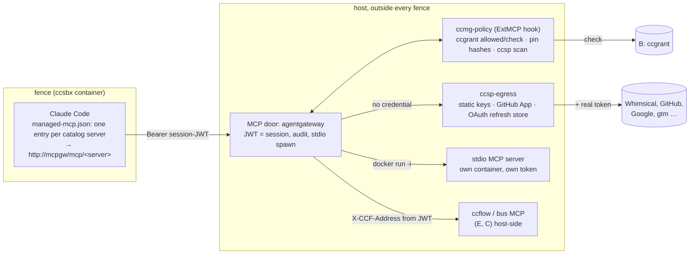

# A. MCP server gateway

**In one line.** Sandboxed sessions reach MCP servers only through one gateway on the host, the **MCP door**.
Claude Code inside the fence is pinned to it by an exclusive `managed-mcp.json`. It authenticates with a
per-session token that is worth nothing outside its own grants. The door is **agentgateway (OSS)**. It filters
`tools/list` and checks every `tools/call` against B's PDP through a small policy hook of ours, which also pins
tool descriptions and redacts responses with ccsp's detector. **Upstream credentials, including OAuth refresh
tokens, live only in ccsp-egress**, which adds them on the way out. So credentials stay in the ccsp family and
MCP awareness lives in the door: two processes, one holder of secrets.



## 1. What Tomas has today

| # | Thing | Where | State |
|---|---|---|---|
| T1 | **Remote HTTP MCP servers configured per project**: `whimsical` (`mcp.whimsical.com`, in hriste and .dotfiles), `gtm` and `magnific` (pharmacy), `graphiti` (`localhost:8050`, agentic-memory-benchmarking). There are no user-scope servers and no stdio servers | `~/.claude.json` `projects.*.mcpServers` | live |
| T2 | **Claude Code holds every MCP OAuth token itself**: 9 entries (gtm, whimsical, magnific, six `plugin:brand-voice:*` connectors) next to the Max login | `~/.claude/.credentials.json` key `mcpOAuth` (plaintext, 0600 [reported, survey-2 §3]) | live. **This is inside the fence if the home is shared** |
| T3 | **GitHub plugin MCP**: `api.githubcopilot.com/mcp/` with a static `Authorization: Bearer` header in the plugin's `.mcp.json` | `~/.claude/plugins/cache/claude-plugins-official/github/*/.mcp.json` | live |
| T4 | **`pharmacy-meds` (`127.0.0.1:30333`) with a literal 71-char `Authorization` header in a git-tracked `.mcp.json`**, copied into ~10 pharmacy worktrees | `~/git/pharmacy/.mcp.json` (last touched in 09ba37d4) | live. **A secret in the worktree**, see ❓ 4 |
| T5 | **claude.ai connectors** reach sessions (`mcp__claude_ai_Claude_Docs__*` appears in hook matchers) | `claude/settings/cc-flow-hooks.json:34` | live |
| T6 | **Hook matchers keyed on MCP tool names** (`mcp__whimsical__create_file`, …) | same file | live. A federated single entry would rename them (§2 R7) |
| T7 | **Porter MCP**: Tomas's own remote MCP server with its own OAuth authorisation server, published on Funnel `/porter-mcp` | `~/git/porter/src/mcp/oauth-store.ts`, ai-tooling-map §Porter | live |
| T8 | **ccsp**: Go, zero third-party modules, redacts secrets in the Anthropic channel, fails closed, uses markers and an incident spool. It **does not inject** credentials and does not see MCP traffic | `~/git/cc-secret-proxy` (pin live on hp per unified §4 ¹; README "nothing live" is stale) | live (model channel only) |
| T9 | **Doc 68's MCP design**: C8 runs "one Deployment per MCP server, own SA, own Secret, egress only to its upstream". A gateway applies "read by default; send/share/delete with allowlist or approval". stdio MCP with `env` secrets in the session is forbidden. Q21 says "agentgateway only for MCP delegation". The company tier uses RFC 8693 per user | doc 68 §3.2, 22-…threats C8, Q21 | draft |
| T10 | **Neighbours**: B's `ccgrant` (`allowed`/`check`/`grant.request`, `register_catalog` from A), E's `ccflow` MCP server "served at the gateway", D's OAuth-connect card and elicitation card | permissions.md §4, orchestration.md §4, surfaces.md §4 | draft (today) |

## 2. What the area must do in the unified model

| # | Requirement | Invariant |
|---|---|---|
| R1 | **No MCP credential inside the fence**: no `mcpOAuth`, no static bearer, no `env` secret in any MCP config the session can read. Today's T2, T3 and T4 must not be mounted or copied into a sandbox home or worktree | no secret inside the fence |
| R2 | **One door, pinned**: the harness can reach MCP only through the door. Its config can't be widened from inside (worktree `.mcp.json`, `claude mcp add`, plugins, `--mcp-config`, claude.ai connectors) | no secret inside the fence |
| R3 | **The session is the caller**: every call carries `<tree>:<node>/g<gen>` from a token the launcher minted, never from text the agent writes. The token dies with the session (B R5) | address is the identity |
| R4 | **Per-session tool policy from B**: `tools/list` shows only allowed tools. Each `tools/call` gets allow, deny or ask, and an ask becomes a ❓ through B, E and D | consent by a human |
| R5 | **Credentials added on the way out**: static keys, GitHub App tokens and OAuth access tokens are minted from refresh tokens held outside every fence. OAuth connect happens in a human's browser, outside the fence | consent by a human, no secret inside |
| R6 | **Every call logged** (address, server, tool, args digest, decision, bytes, latency; counts and ids, never values) and **responses redacted** with ccsp's detector and markers | — |
| R7 | **Tool names stay stable** (`mcp__<server>__<tool>`) so hooks, B's policies and `permissions.deny` keep matching | — |
| R8 | **Tool-poisoning defences**: pin each tool's canonical definition at approval. Hide the tool and raise an incident on drift. Cap description and output sizes. Mark output as untrusted provenance | — |
| R9 | **Degrades, never blocks**: if the door is down, MCP tools fail and the session runs on. Local starts don't need it. The door runs per machine, beside ccsp | sessions don't depend on the backend |
| R10 | **Lifecycle stays with tmux**: the door never starts, stops or resumes a session. Revocation follows pane exit (B4) | tmux owns lifecycle |
| R11 | **Same contract on pod and company tiers**: per-user delegation (RFC 8693) and Deployments per server replace host pieces without changing the session-side contract | — |

The **MCP spec (2026-07-28)** shapes R3 and R5. A server MUST accept only tokens issued for it (no passthrough).
RFC 8707 `resource` is mandatory, CIMD is preferred over the now-deprecated DCR, and `iss` must be validated
[documented, survey-2 §1]. So the door is an **MCP server** to the session, with its own audience-bound session
token, and an **OAuth client** to each upstream. The two tokens never cross. A proxy with one static client ID
MUST do per-client consent. Here there is a single human, and the connect card is that consent.

## 3. Outside solutions

Survey: 13 products plus the spec, poisoning research and Claude Code's controls; details and URLs are in the two
evidence files. **No candidate covers the whole brief in OSS.** The gaps are refresh-token custody (paid in
agentgateway, absent in Agent Router, Docker and Microsoft), rug-pull pinning (nobody blocks drift on
`tools/list` [reported]), and per-session identity with stdio isolation together.

**Shortlist** (1 = poor, 5 = good; "vendor" = low single-vendor risk is good):

| Candidate | Maturity | Self-host | License | Vendor | Solo fit | 500 fit | Verdict |
|---|---|---|---|---|---|---|---|
| **agentgateway** 1.7.0 (2026-10-27) | 3 | 5 | 5 Apache | 3 (LF/AAIF, Solo-led, Enterprise split) | 4 | 5 | **front door**: JWT claims → CEL per-tool authz with filtered `tools/list`, ExtMCP hook on request and response, stdio, k8s controller, OTel [documented]. Upstream refresh store and fingerprinting are Enterprise [reported]. OSS token exchange announced 2026-07, presence in 1.7.0 unverified |
| Agent Router (ex Envoy AI GW) 1.2.1 | 3 | 5 | 5 Apache | 5 (AAIF, 5 vendors) | 3 | 4 | runner-up door: CEL authz, stdio in standalone mode, no credential store, thinner guardrails [documented]. Swap target if Solo moves features to Enterprise |
| Pomerium (v0.33+) | 4 | 5 | 3 (Apache source, community-licensed builds) | 3 | 3 | 4 | **best OSS-ish OAuth custody**: upstream OAuth client (CIMD/DCR), caches and refreshes per-user tokens, `mcp_tool` policy, logs calls [documented]. No stdio, no redaction, MCP edition gating not stated. Fallback for custody |
| Obot 0.27 | 3 | 4 | 4 MIT + license key (100-user cap free) | 2 | 2 | 4 | closest single product (hosts stdio as containers, OAuth custody, vMCP per group, audit export) [documented]. A whole platform overlapping CC Flow; online license check; 3 CVEs in 2026 including token theft [reported]. Revisit for the 500-tier non-developer surface (doc 68 §26 row 8) |
| IBM ContextForge 1.1.1 | 3 | 5 | 5 Apache | 2 | 2 | 3 | only OSS with a per-user refresh store (DB or Vault) [documented]. 2026 CVEs at 9.8 (hardcoded JWT secret) and 10.0 plus SSRFs [reported]. No |
| Docker MCP Gateway 0.44.3 | 3 | 4 | 5 MIT | 2 | 3 | 1 | best stdio isolation (container per server, signed images, `--block-secrets`) [documented]. No session identity, no k8s. **Use the pattern**, not the product |
| NVIDIA OpenShell | 2 | 5 | 5 Apache, CNCF Sandbox | 3 | 2 | 3 | right credential model (placeholder inside, inject on destination match, refresh kept at gateway) [documented] but **not MCP-aware**. Doc 68 Q42 spike stands |
| Microsoft MCP GW, Kong, Traefik Hub, Lasso, MetaMCP | — | — | — | — | 1 | 1–3 | no: Microsoft has no injection or allowlist; Kong MCP plugins are Enterprise; Traefik is commercial and forwards the caller's token; Lasso has been quiet since 2026-01; **MetaMCP archived 2026-11-12 with a 9.8 RCE** [reported] |

**RECOMMENDED 3RD PARTY, per sub-layer**

| Sub-layer | Pick | Why, and what we build around it |
|---|---|---|
| L1 MCP front door (session auth, list filter, per-call enforce, audit, transports) | **agentgateway OSS**, standalone YAML on hp/Mac → its k8s controller on pods | the only OSS door with claim-based identity, filtered `tools/list`, a request/response hook and stdio, under a foundation. Keep **our policy in the hook**, not in CEL, so the door stays replaceable (Agent Router) |
| L2 Credential custody and injection (static, GitHub App, **OAuth refresh**) | **build: ccsp-egress** gets an MCP route class and a small OAuth client | nothing OSS stores refresh tokens without a paid edition or a poor CVE record. Doc 68 already makes ccsp-egress the one holder of upstream credentials. The OAuth client is spec-shaped: PRM discovery, CIMD or pre-registration, PKCE, RFC 8707, refresh, encrypted at rest under the `ccsp` uid. **Fallback: Pomerium** as the custody hop if this slips |
| L3 stdio servers | **docker container per server**, spawned by the door as a stdio backend (`docker run --rm -i`, own network, own credential) | Docker MCP Gateway's pattern without its identity gap. Not needed today: Tomas runs no stdio servers |
| L4 Tool poisoning | **build** (pinning in `ccmg-policy`) + optional **Snyk agent-scan** at catalog registration | no product pins on `tools/list` [reported]. agent-scan needs a SaaS token, so it is off by default |
| L5 Response redaction | **ccsp's detector** via the ExtMCP response hook | already built and tested. One detector, one marker format |
| L6 Pinning Claude Code | **`managed-mcp.json`** (exclusive), `disableClaudeAiConnectors`, `deniedMcpServers` | documented: exclusive load, blocks `claude mcp add`, plugins and `--mcp-config`, and suppresses claude.ai connectors [documented, survey-2 §3] |
| Company tier | agentgateway k8s + OpenBao as the token store + RFC 8693 per user (OSS if shipped, else Solo Enterprise or Pomerium); one Deployment per stdio or self-hosted server (doc 68 C8) | same session contract |

**One gateway or two, and how it relates to ccsp.** The answer is two processes, one secret holder. ccsp-model
stays the model channel. The **MCP door holds no secrets**: it speaks MCP and enforces policy. ccsp-egress holds
every upstream credential (git route, HTTP egress, MCP upstreams). Folding MCP into ccsp would put a JSON-RPC
state machine (sessions, SSE, `list_changed`, elicitation) into the security-critical zero-dependency proxy.
Putting the model behind agentgateway instead (doc 68's fallback) would throw away ccsp's live redaction and
key pinning. The cost is one extra hop and one more process per machine.

**How the session token works without putting a secret inside the fence.** `ccsbx run` mints a JWT signed by
a host key the fence can't read. Its fields: `aud=mcpgw`, `sub=<tree>:<node>`, `gen`, `exp` = 24 h. It is
mounted read-only at `/run/ccf/mcp.jwt`. A `headersHelper` prints `{"Authorization":"Bearer …"}`. It runs on
every connect and retries once on 401 [documented]. The token unlocks only what B grants that session, it dies
at pane exit (B4 → the door rejects `gen` once revoked), and on `sandbox` the door also binds it to the
container's IP on `ccsbx-net`. This is the same class as doc 68's pod identity token: an identity, not an
upstream credential.

**Pinning Claude Code**: this goes in the sandbox image's `/etc/claude-code/managed-mcp.json`, baked by unified
item 1. It has one entry per **catalog** server (`whimsical`, `github`, `gtm`, … `ccflow`), each
`{"type":"http","url":"http://mcpgw:8790/mcp/<server>","headersHelper":"cat-jwt"}`. A catalog server is in
the file even when this session has no grant yet. The door then returns an empty `tools/list` and, after a
grant, sends `list_changed`, so tools appear **without a restart**. Also set `disableClaudeAiConnectors: true`,
`ENABLE_CLAUDEAI_MCP_SERVERS=false`, and `CLAUDE_CODE_MAX_MCP_DESCRIPTION_LENGTH` and `MAX_MCP_OUTPUT_TOKENS`
as caps. Effect: a worktree's `.mcp.json` (T4) is ignored, plugin MCP (T3) never loads, and tool names stay
`mcp__<server>__<tool>` (R7).

**Tool-poisoning defences, layered, none sufficient alone.**
1. **Pin** a sha256 of the canonicalised tool definition (name, description, inputSchema, annotations) at
   catalog registration (B `register_catalog`). On `tools/list` or `list_changed`, a drifted tool is hidden
   for every session, an S2 incident goes to the ccsp spool, and re-approval means a new catalog entry.
2. **Cap and show**: description length cap, and full descriptions shown on the ❓ card for a new server.
3. **Redact** responses (secrets → markers) and stamp `provenance: untrusted` on each tool result as B context,
   so a later `send`-class call in the same turn is `ask`, never `auto` (a simple taint, B's policy).
4. **Bound the capability**, which is the real defence. Injected output can't be stopped (MCPTox: 36.5 %
   mean ASR across 20 agents [reported]), so reads are default and send/share/delete are ask with recipient
   allowlists (doc 68 C8), and each upstream token is scoped narrowly.

## 4. Contracts with the other four areas

**→ B (permissions).** A calls `allowed(session, mcp.call, McpTool)` at connect and on `grant.applied`/
`grant.revoked` events to shape `tools/list`. It calls `check(session, mcp.call, McpTool,
{provenance, args_digest, gen})` on every `tools/call` (cache ≤ `cache_ttl_s`), and `grant.request` on `ask`
(the call returns an MCP error naming the `ar-…` id). A also calls `check(…, credential.use,
CredentialRoute)` before ccsp-egress injects. B calls `register_catalog(server, tools[{name, annotations,
pinned_hash}])` *from* A. Matches permissions.md §4 exactly.
```
tools/call audit line (A → spool, also cc-events): {ts, address, gen, server, tool, args_digest,
  decision, policy_ids[], grant_ids[], upstream_status, bytes_in, bytes_out, redactions, ms}
```

**→ C (cooperation: hub, context).** C's agent tools (`ccf-coop`: `bus_*`, `ctx_*`, `note_propose`,
`art_share`) are, on `sandbox`, a **credential-free stdio server inside the fence** that only writes to the
spool door (cooperation.md §4). A accepts that. It is the one non-door entry allowed in the image's
`managed-mcp.json`, listed by exact `serverCommand`, and it works with the door down (R9). On `pod`, A serves it
as catalog server `ccf` with `X-CCF-Address`/`X-CCF-Gen` set from the JWT (any copy the agent sends is
stripped). **A agrees with C: `ccf-coop` and E's `ccflow` become one server `ccf` with one verb table.**

**→ D (surfaces).** Two cards, both through B and E. (1) **OAuth connect**: `grant.request(credential.use,
CredentialRoute::"mcp-whimsical")` → card with ccsp-egress's authorise URL → the human finishes in a browser
outside the fence → the token lands in ccsp-egress → `grant.applied` → `list_changed`. (2) **Elicitation**:
the door turns a server's `elicitation/create` into a ❓ card and returns the answer. Agreed with surfaces.md
§4 for v1. If agentgateway can't proxy elicitation, the door answers `decline` and logs it (inferred).

**→ E (orchestration).** E's LaunchSpec carries `grants_ref` and the catalog set. `ccsbx run` mints the JWT
and writes `managed-mcp.json` from it (with E3). E's `ccflow` MCP server is catalog server `ccflow`. The door
routes it to the host-side door socket with the address headers, so E trusts the header, never a body field.
E calls `revoke({session, gen})` on pane exit and the door drops the session at the next call. A never
launches, stops or resumes anything.

## 5. Build list delta (on top of unified §3, permissions §5, orchestration §5)

| # | Piece | Size | Order / after | Works when |
|---|---|---|---|---|
| A0 | **Pin in the image**: exclusive `managed-mcp.json` (catalog entries → door), `disableClaudeAiConnectors`, size caps; never mount `~/.claude/.credentials.json` or `~/.claude.json` from the host; drop `.mcp.json` from the worktree mount's trust | XS | with unified item 1 | in a sandbox `claude mcp list` shows only door entries and `ccf`; `claude mcp add x …` fails; pharmacy's `.mcp.json` loads nothing; grep of home and env finds no `mcpOAuth` |
| A1 | **Session JWT**: `ccsbx run` mints, mounts `/run/ccf/mcp.jwt`, `headersHelper`; host key unreadable from the fence; door checks `aud`, `exp`, `gen`, source IP | S | after A0 | a call with the token from another container's IP or after `/exit` gets 401 |
| A2 | **Door up**: agentgateway standalone in docker on `ccsbx-net` + egress bridge, JWT auth, one no-credential route (`graphiti` or a test echo server), audit JSONL to the spool, `--help`-documented config | S | after A1 | a sandboxed `say hi` uses the echo tool; the audit line shows address, tool, digest |
| A3 | **`ccmg-policy`** ExtMCP hook (Go, beside ccsp, zero deps): `allowed`/`check` against `ccgrant`, ask → `grant.request`, `register_catalog` + hash pinning, drift → hide + incident, fail closed | S–M | after A2 and B2 | an unlisted tool is absent from `tools/list`; a `create_pull_request` call returns ask with an `ar-` id and passes after `'<id> 1'`; editing a fake server's description hides that tool |
| A4 | **Response redaction**: hook sends results through ccsp scan | S | after A3 | a planted fake key in a tool result reaches the model as a marker; an incident is spooled |
| A5 | **ccsp-egress MCP routes, static**: bearer injection per route (GitHub App token for `github`, `pharmacy-meds`) | S | after unified item 5 | GitHub MCP works from a sandbox with no PAT anywhere in the fence or the plugin config |
| A6 | **ccsp-egress OAuth client**: CIMD or pre-registered client, PKCE, RFC 8707, `iss` check, refresh, encrypted store under `ccsp` uid, connect via D's card, `revoke` | M | after A5, B5, D's card | Whimsical works from a sandbox; restart keeps the token; revoke stops the next call; the fence has no token |
| A7 | **Tests** (ccsp style, fakes only): block + allow per control above, run on every Claude Code bump (pin behaviour is version-dependent) | S | grows with A0–A6 | the suite goes red if `managed-mcp.json` is removed or a door route skips the hook |
| A8 | **`ccf` (= `ccflow` + `ccf-coop`)**: on sandbox the in-fence stdio entry in A0; on pod a door route with address headers | XS | after E5 / C11 | a worker's `outcome.set` lands on its own node only; on pod a forged `X-CCF-Address` is overwritten |
| A9 | **stdio runner**: `docker run --rm -i` backend template (own network, own env credential) | S | first stdio server | a stdio server's token is visible in its container, not in the session's |
| A10 | **local tier opt-in**: `claude!` on `local` points MCP at the door; move T2's tokens out of `~/.claude` (re-consent) | S | after A6 proven for 2 weeks | `~/.claude/.credentials.json` has no `mcpOAuth`; local Whimsical still works |
| A11 | company: k8s controller, OpenBao store, RFC 8693 per user, Deployment per server | L | first client | doc 68 C8 tests pass |

**Minimum for "a sandboxed agent uses one real MCP tool with no credential inside"**: A0 + A1 + A2 + A5 (XS + S
+ S + S), with the static GitHub route. A3 is needed before any send-class tool.

## 6. Risks and conflicts

**Top 3 risks**
1. **Our own code on the security path** (doc 68 MR-08/MR-11): `ccmg-policy` and the OAuth client are new
   custom security components (#7 and #8 against doc 68's budget of about 6). Mitigate: fail closed, zero deps,
   ccsp's test discipline (A7), small surface (the hook only decides, the door only routes), spec-shaped OAuth
   with the RFCs named in tests.
2. **agentgateway is young and Solo-led**, with an OSS/Enterprise line that has already moved token storage
   and fingerprinting to paid [reported]. Mitigate: policy lives in our hook, the session contract is plain
   MCP plus a bearer, so Agent Router can swap in (both use CEL and support stdio). Re-check at each minor
   release.
3. **Injected tool output and Claude Code drift.** Pinning catches changed definitions, not malicious results.
   `managed-mcp.json` exclusivity and `headersHelper` are vendor behaviour that can change. Mitigate:
   capability bounds (read default, send = ask, taint), Claude Code version pinned in the image, A7 on every
   bump.

**CONFLICTS**
- **Doc 68 Q21 ("agentgateway only for MCP delegation", company tier).** I adopt agentgateway **as the MCP door
  from the solo sandbox tier**, because B's per-tool grants need an MCP-aware enforcer and ccsp isn't one.
  Credentials stay out of it, consistent with doc 68's warning about its token store.
- **Doc 68 §3.2 / C8 ("each credentialed MCP server runs as its own pod with its own Secret").** Most of
  Tomas's servers are **remote SaaS** (Whimsical, gtm, magnific, GitHub) with nothing to run. For those, the
  credential sits in ccsp-egress and is injected on the way out. Pod-per-server applies to stdio and
  self-hosted servers (A9, A11). This is a refinement, not a reversal.
- **E (orchestration.md §4, "the gateway resolves which MCP servers the session sees").** Claude Code fixes
  its server entries at spawn, so the *set of entries* is the catalog, written at launch. Grants change only
  which tools each entry returns. A server added to the catalog mid-session needs a fresh start, which is
  acceptable because catalog changes are reviewed rollouts (doc 68 21-… line 542).
- **B (permissions.md B7, a PreToolUse `ccgrant` check for `mcp__*`).** Fine as a speed bump on `local`. On
  `sandbox` the door is the enforcer and the hook must not be the only check. No disagreement, just tier
  wording.
- **C (cooperation.md §4, `ccf-coop` as an in-fence stdio server on sandbox).** Accepted, with one
  condition: it holds no credential and no network, and its only writable target is the spool door. Then
  the door stays the sole path to anything credentialed. On pod it moves behind the door. No conflict
  with D.

## 7. Decisions for Tomas (❓ under ai-tooling:#5w5b)

1. **MCP front door**: agentgateway OSS (rec) · Agent Router · build MCP into ccsp · Obot as a platform.
2. **Refresh-token custody**: build an OAuth client into ccsp-egress (rec) · Pomerium as the custody hop ·
   leave OAuth servers unavailable in sandboxes until the company tier.
3. **Today's 9 `mcpOAuth` tokens**: re-consent each server through the door when it is first needed in a
   sandbox, then `claude mcp logout` locally (rec) · copy Claude Code's existing refresh tokens into
   ccsp-egress (they're bound to Claude Code's client registration, so this is fragile) · leave local
   as is indefinitely.
4. **`pharmacy/.mcp.json` literal `Authorization` header in git** (T4): move it to an env reference now and
   rotate the token, then a ccsp-egress route (A5) (rec) · accept it as a dev-only localhost token and only
   exclude it from sandbox mounts.

¹ The README in `~/git/cc-secret-proxy` says "nothing installed or live yet". Unified §4 observed hp's
managed settings pinning `ANTHROPIC_BASE_URL` to ccsp, and the ccsp hook guards `/etc/claude-code` on hp. So
the pin is live on hp and the README is stale.
