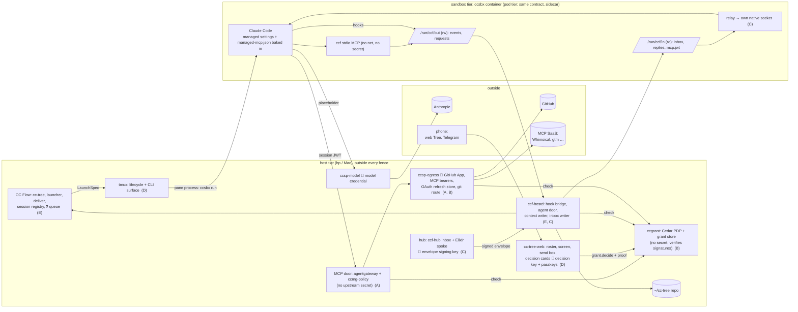

[Index](README.md) › Unified model

# Unified model

**In one line.** A session is a tree address (`<tree>:<node>/g<gen>`) that CC Flow places on a
host tier and drives through a harness adapter. Each tier runs it inside a fence that holds no secret.
The fence has four doors out. Each sits on the host and checks the session's identity, never text the
agent wrote: **ccsp-model** (the model), the **MCP door** (agentgateway), **ccsp-egress** (every other
upstream credential, including git), and **ccf-hostd** (a file spool for tree verbs, hook events
and messages). One embedded Cedar PDP (`ccgrant`) answers "may it?" for all four. Only a human with
a proof an agent can't make widens a grant. The detail stays in the area docs. This page is the
merge: what is decided, what conflicts, what to build first, and what Tomas still decides.

## 1. The picture

**Tiers.** `local` = today's tmux pane on the host (no fence; consent is recorded, not
enforced). `sandbox` = a docker container as the pane's process (v1, measured 0.45 s cold).
`host-uid` = Mac only (docker there means a VM; ❓ #3g4a). `pod` = after G1: the same LaunchSpec,
with a sidecar instead of ccf-hostd and an attach through `ccattach`. `client cell` = its own cluster,
with backends swapped (Postgres, OpenBao, Keycloak, Kata); the session contract stays the same.

**Who holds secrets.** Upstream credentials sit only in ccsp-model and ccsp-egress. Three more host
keys sit outside every fence and are never mounted: the hub's Ed25519 envelope key, the
launcher's JWT signing key, and cc-tree-web's decision-signing key (with Tomas's passkey public keys).
The fence holds placeholders, a session JWT that is worth only its grants and dies at pane exit, and the
worktree. The MCP door, ccgrant, ccf-hostd and the relay hold nothing that works outside.

**Invariants (merged; reworded where an area changed them).**
1. **The address is the identity.** `<tree>:<node>/g<gen>` exists before any process. Every door
   stamps identity from the pane, the container or the JWT, **never from the request body or
   message text** (A R3, C X2, E door). Harness session ids are stored verbatim and mapped.
2. **Only the host's owner ends a session.** tmux owns the lifecycle on local, sandbox and host-uid.
   A pod stops only through drain at a turn boundary. A change to `Host:`/`Harness:`/grants
   applies at the **next generation**, never by restarting a live session (v1 C1 + E X2; ❓ #5gbg).
3. **No secret inside the fence.** That covers upstream credentials, `mcpOAuth`, static MCP bearers,
   bus secrets and signing keys. The host's `~/.claude.json`, `.credentials.json` and
   `~/cc-tree` are never mounted (A R1, C, E).
4. **Enforcement is outside the fence.** In-fence hooks and `permissions.deny` are speed bumps.
   The PEPs are the four doors plus the launcher (B R10).
5. **Consent comes from a human with a proof** an agent can't make, tiered: `header` for low,
   passkey/OTP for medium, passkey for high (B R6 + D). Authority never travels as text: no message,
   manager or service account approves (C "authority does not travel", B, E X5).
6. **Ceilings before prompts.** `forbid` wins, the auto tier runs before any ❓, and every grant expires
   at the enforcer and dies with its session or generation (B R3–R5).
7. **Sessions don't depend on the backend.** local and sandbox start offline. If the hub, web, door or
   PDP socket is down, that feature degrades and the session runs on. Sends go `queued-local`
   (harness doc, A R9, C).
8. **The launcher chooses the billing mode** per session and records it. Nothing switches it
   silently: `local` keeps the API-key scrub, while sandbox and pod get a placeholder and the gateway
   decides (v1 C4, replacing the harness doc's scrub-only rule).
9. **One way out per channel.** The model goes through ccsp-model, MCP through the door, git and HTTP
   through ccsp-egress, and tree verbs and messages through the ccf-hostd spool. The sandbox has no other
   egress, and the host commits and pushes.
10. **Observation goes one way.** The fence writes only to `/run/ccf/out`, reads only `/run/ccf/in`
    and its worktree, and never calls tmux, the tree or the hub.
11. **CC Flow decides; the layers execute** (ADR-0007). Which session, where, under which harness and when
    is CC Flow's call. The hub never creates, reseeds, approves or writes the tree (C's ten NOT rules).
12. **Context moves by reference, through one stamped writer.** Untrusted text never becomes an
    instruction, and a `proposed` note is never injected (C X1–X6).

## 2. Components

| Component | Area | Buy / build | Why | Replaces / extends today's |
|---|---|---|---|---|
| CC Flow (tree, ❓, managers, arming, placement, `deliver`, session registry) | [E](model/orchestration.md) | **build** (keep) | nothing ships it; it is the product | cc-tree, extended with `Host:`/`Harness:`/`Grants:` and a LaunchSpec |
| tmux (lifecycle host + CLI surface) | [D](model/surfaces.md) | **buy** tmux 3.4 (hp) | ~150 `tmux()` calls, `capture-pane`, `attach -r` | same, unchanged |
| `ccsbx run` (fence launcher, JWT mint) | v1, [A](model/mcp-gateway.md), [E](model/orchestration.md) | **build** on **docker 29.9** (+ gVisor later) | 0.17 s over a plain start; docker is already on hp | v1 `spike/bench.py` |
| Harness adapter (`cc_tree_harness.py`) | [E](model/orchestration.md) | **build** thin; borrow ACP vocabulary | no pretended parity across harnesses | Claude specifics spread through cc_tree.py |
| ccf-hostd (hook bridge + agent door + context writer + inbox writer) | v1, [E](model/orchestration.md), [C](model/cooperation.md) | **build** | the fence's only path to CC Flow; one mount and one tailer (E4 says the same) | sb-hook / cc-tree-hook.sh writing directly |
| `ccf` MCP server (one verb table) | [A](model/mcp-gateway.md), [C](model/cooperation.md), [E](model/orchestration.md) | **build** | `ccf-coop` + `ccflow` merged (A and C agree) | `/cc-task`, `ccmsg` shell calls inside the session |
| Hub (`ccf-hub` SQLite inbox, receipts, signing, scoped directory) | [C](model/cooperation.md) | **build**; **SQLite** solo, **Postgres** company | no product signs, scopes or tenants | session-bus (Elixir) → presence and routing only, in shadow |
| In-fence relay (~100 lines) | [C](model/cooperation.md) | **build** on Claude Code native messaging | host↔container sockets don't connect [documented] | v1 item 4b socket mount (superseded) |
| ccgrant (PDP, grant store, revocation) | [B](model/permissions.md) | **buy cedar-go 1.9.3** + **build** the store | forbid-wins = ceilings; offline; provable in CI | AUTONOMY prose, deploy-scope |
| MCP door | [A](model/mcp-gateway.md) | **buy agentgateway OSS 1.7.0** | claim-based identity, filtered `tools/list`, ExtMCP hook, stdio | per-project `mcpServers` with tokens in `~/.claude` |
| ccmg-policy (ExtMCP hook: ccgrant, pinning, redaction) | [A](model/mcp-gateway.md) | **build** (Go, zero deps) | policy stays ours so the door stays swappable | none |
| ccsp-model | v1, doc 68 | **build** (extend) | redaction + key pinning are live; needs injection | ccsp (redacts only today) |
| ccsp-egress (static routes, GitHub App, OAuth client, path-aware git route) | [A](model/mcp-gateway.md), [B](model/permissions.md) | **build** | nothing OSS holds refresh tokens without a paid tier or bad CVEs | gh OAuth / PATs in shells |
| cc-tree-web: roster, screen view, send box, decision cards + passkey | [D](model/surfaces.md), [B](model/permissions.md) | **build** (keep) | ~150 lines on today's page; no product fits | web Tree (header auth only) |
| Notifications | [D](model/surfaces.md) | **buy** Telegram inline keyboard (have it) + Web Push | low tier one tap, the rest deep links | notify-tomas-telegram, msg-router |
| Knowledge notes + FTS5 index | [C](model/cooperation.md) | **build** thin; **Graphiti** as an index | git is the truth with scoped writes | per-project memory, `/learn` → Graphiti |
| Timing (schedules, verify days) | [E](model/orchestration.md) | **keep tschedule**; Temporal at a client | ~70 timers don't need a cluster | same |

## 3. Recommended third party (consolidated)

| Layer | Solo pick | Client-tier pick | Runner-up | Main risk |
|---|---|---|---|---|
| Fence runtime | docker 29 + runc, hardened flags | k3s 1.36 + gVisor, Kata on bare metal | host users (Mac) | shared kernel until gVisor (❓ #6aw3) |
| Lifecycle / CLI host | tmux | tmux behind `ccattach` | zellij 0.46 (no user options) | none worth noting |
| MCP door | agentgateway OSS 1.7.0 standalone | agentgateway k8s controller | Agent Router 1.2.1 | Solo-led, Enterprise moving features to paid |
| MCP OAuth custody | build into ccsp-egress | + OpenBao store, RFC 8693 per user | Pomerium v0.33+ | our own code on the security path |
| stdio MCP servers | container per server (Docker MCP Gateway's pattern) | Deployment per server (doc 68 C8) | Docker MCP Gateway | none today (no stdio servers) |
| Tool-poisoning scan | optional Snyk agent-scan at registration | same | — | SaaS token; off by default |
| PDP | Cedar (cedar-go embedded; Rust CLI + analyser in CI) | same, store on Postgres | OpenFGA 1.22.1 | cedar-go lacks templates (one policy per grant) |
| Decision wire format | AuthZEN Access Evaluation 1.0 | same | — | — |
| GitHub credential | GitHub App installation tokens (1 h, downscoped) | same | — | — |
| Google credential | service account + per-file share | per-user OAuth `drive.file` + Picker | — | per-permission expiry unverified |
| Dynamic secrets | none (SOPS + gateways) | OpenBao 2.7.2 | (Vault: BUSL, no) | — |
| Message shapes, directory | A2A 1.0 shapes (Agent Card, JWS over JCS) | same | AGNTCY (watch) | — |
| Inbox store | SQLite (WAL) + long poll | Postgres (SKIP LOCKED, RLS) | NATS JetStream (fan-out only) | Jepsen found lost writes on NATS 2.12.1 |
| Last hop into Claude Code | native cross-session messaging + relay | same, via sidecar | bracketed paste / send-keys | the posting protocol is undocumented and changes per release |
| Retrieval | rg → SQLite FTS5 → Graphiti (kept, as an index) | same | Basic Memory 1.0 (AGPL) | — |
| Provenance | git trailers + signed commits | in-toto / Sigstore | — | — |
| Web attach | build (capture-pane text) on Tailscale identity | oauth2-proxy + Keycloak; Coder OSS if IDEs are asked for | ttyd `-r` (reserve) | web Tree becomes the high-value target |
| Terminal attach | Tailscale SSH / operator proxy | Teleport Enterprise or attach gateway + OpenBao SSH CA | — | `tsrecorder` end of support Aug 2027 |
| Notifications | Telegram inline keyboard (low tier) + Web Push | Web Push | ntfy | Telegram compromise (so low tier only) |
| Durable workflows | tschedule + node fields | Temporal (MIT) | — | — |
| Harness protocol | build thin, ACP vocabulary | ACP for headless Codex/OpenCode | — | ACP over Claude = SDK, not the TUI |
| Hosted cloud agents | none | GitHub Agent HQ / OpenHands Enterprise | — | vendor lock-in |

## 4. Conflicts

**R** = resolved, and the winning doc is named. **❓** = Tomas decides (§6). **R + ❓** = the direction is resolved and a detail is still open. "v1" = unified-session-model.md.

| # | Source | Conflict | Outcome |
|---|---|---|---|
| 1 | v1 C1 | harness "never terminate/resume" vs doc 68 pods stopping after idle | **❓ #5gbg**. Invariant 2 above is the proposed wording, and E and D already assume it |
| 1b | E X2 vs harness doc | a live session changing `Host:`/`Harness:` | **R** E: the change applies at the next generation (fresh start or roll at a turn boundary), never by restarting |
| 2 | v1 C2 | tmux in the pod vs one tmux | **R** v1: one host tmux until pods; D agrees |
| 3 | v1 C3, C K2/K3, E X6 | Channel server vs sidecar vs socket mount | **R + ❓** C: native inbox reached by an **in-fence relay**. v1 item 4b (socket mount) is superseded; Channels are never needed. The relay's shape is still ❓ #5gf6 (a spike first) |
| 4 | v1 C4 | API-key scrub vs gateway Console key | **R** v1: invariant 8; E records `billing` in the SessionRecord |
| 5 | v1 C5 | Max login token inside the client vs no secret inside | **❓ #6f24**: this gates the critical path (§5) |
| 6 | v1 C6–C9 | backend dependence, hooks endpoint, Agent View, Remote Control | **R** v1. C7's hook spool becomes ccf-hostd's `out/`; C9 is executed by D9 (drop `cc-rc`) |
| 7 | v1 §2 | host users (doc 68 rung 0b) vs a container per session | **❓ #3g4a**. It now also depends on #6d6g (§6) |
| 8 | A vs doc 68 Q21 | agentgateway only at the company tier | **R** A: it is the MCP door from the sandbox tier on, and **holds no credentials** (doc 68's token-store warning kept) |
| 9 | A vs doc 68 C8 | a pod per credentialed MCP server | **R** A (a refinement): remote SaaS gets an injection route in ccsp-egress; pod or container per server only for stdio and self-hosted servers |
| 10 | A vs E §4 | "the gateway resolves which servers the session sees" | **R** A: the catalog of entries is fixed at spawn (`managed-mcp.json`), grants shape `tools/list`, and a new catalog server needs a fresh start |
| 11 | A vs B B7 | PreToolUse `ccgrant` hook as a PEP | **R** (tier wording): it is a speed bump on `local`, and the door enforces on sandbox. B's footnote 2 marks behaviour under `--dangerously-skip-permissions` as untested. Earlier dotfiles work found PreToolUse still fires under bypass (not re-tested here); `permissions.deny` under bypass is unverified and gets tested first in U17 |
| 11b | B vs A (B wrote before A) | if the gateway runs its own policy engine, tool grants get two sources | **R** A: the door's policy is ccmg-policy, which calls `ccgrant`, so tool grants keep one source |
| 12 | A/C/E | `ccf-coop` (C) and `ccflow` (E) as separate MCP servers | **R** A + C: **one server `ccf`**, with the verb table in §5 note ¹. On sandbox it is the only non-door entry in `managed-mcp.json`: stdio, no network, writes only `out/`. On pod it sits behind the door with `X-CCF-Address` set from the JWT |
| 13 | B vs doc 68 25 §2.3 | AccessPolicy YAML evaluator | **R** B: the AccessRequest contract, tiers and anti-pattern tests stay; Cedar replaces the YAML evaluator (engine choice is **❓ #55ca**); rate limits stay as ccgrant counters |
| 14 | B vs doc 68 | milestone grant TTL 30 d vs 7 d | **❓ #6dvg** |
| 15 | B vs doc 68 | grants enforced only at network or kube level | **R** B: a path-aware check on doc 68's existing git route (K12); no new component |
| 16 | B vs E §2 | who holds the authoritative grant record | **R** B: signed `grants-*.jsonl`, with the ❓ node as UI and log. E's X5 (Arm! = a ceiling Tomas approves at arm time) fits B's `profiles/` |
| 17 | B vs E §4 | `grant.resolve` returns `ceiling_id` (E) vs ceiling + grant ids (B) | **R** B (saves A a second call) |
| 18 | D vs B, D vs E (D's proof field) | `grant.decide(…, by=human)` and WebAuthn only on high | **R** D: B's API already carries `approver, channel, nonce, sig, proof`, and medium needs a passkey or OTP. E's §4 signature is outdated; read B §4 |
| 19 | B vs ccsp | the "zero modules" rule vs cedar-go | **R** B: `ccgrant` is its own binary, and ccsp-egress calls it over the socket |
| 20 | B vs harness doc | "single designated approval responder" | **R** B: that covers tool prompts only; grant approval is always a human on a surface |
| 21 | C K1 vs doc 68 K7 | company inbox on NATS vs Postgres | **❓ #4tq4** |
| 22 | C K4, E §4, D §4 | envelope kinds `message/tick/answer/work` vs doc 68's eight | **R** C: doc 68 kinds. Human sends become `dispatch`/`answer`, `tick` becomes `notice`, `work` becomes `dispatch` |
| 23 | C K5 vs E E5 | workers can't message until v2 | **R** C: `msg.reply`/`msg.send` to the worker's own owner or manager is in door v1 (U3); free addressing stays v2 |
| 24 | C K6 vs D | `injected` vs `delivered` | **R** C: `delivered` on the wire, and D may label it "injected" |
| 25 | C K7 | messaging-hub as the agent hub | **R** C: it is a human-channel ingress only (it holds channel credentials, MR-39) |
| 26 | C K8 | Graphiti as the truth for `/learn` | **❓ #5vcs** |
| 27 | C K9 vs B | missing actions; provenance vs trust words | **R** C: B adds `context.write`, `note.accept`, `broadcast`; the envelope `trust` maps 1:1 from B's `provenance` |
| 28 | C vs E X4 | owner of the session registry | **R** E: CC Flow owns it and the hub caches it; C agrees |
| 29 | E X1 vs doc 68 | the agent door arriving only with session-api after rung 3 | **R** E: the spool door now is the solo session-api, with the same verb table |
| 30 | E X3 | sandboxed managers can't reach tmux | **❓ #2sw2**: managers stay local until door v2 |
| 31 | D vs doc 68 Q4 | phone screen view only after G1 | **❓ #5sxw** |
| 32 | D vs doc 68 | a separate write origin for the send box | **R** D: deferred until the web Tree leaves hp; nonce + confirm + passkey on one origin (ties to ❓ #52ds) |
| 33 | D vs doc 24 | Remote Control primary, web terminal fallback | **R** D + doc 68: RC gone, no browser terminal by default |
| 34 | new (F) | socket path: v1 `/tmp/cc-socks` vs C `/run/user/<uid>/cc-socks` | **R**: both directories exist on hp today [observed]. Moot, because the relay reads `messagingSocketPath` from its own `sessions/*.json` |
| 35 | new (F) | one `/run/ccf` mount, both written by the fence (spools) and kept read-only (JWT, inbox) | **R**: split it in two, `/run/ccf/out` (rw: `events.jsonl`, `requests.jsonl`) and `/run/ccf/in` (ro: `inbox/`, `replies.jsonl`, `mcp.jwt`) |
| 36 | new (F) | count of custom security components: doc 68 budgets ~6, the areas add up to 12 | **❓ #5r3g**: merged to 9 here (door + writer + hook bridge = ccf-hostd; the OAuth client inside ccsp-egress) |

## 5. Merged build list

Sizes: XS < ½ day, S ≈ 1–2 days, M ≈ a week, L = a project. 🔑 = needs Tomas's action (a credential,
a passkey, a review). # = needs root on hp. Sources: v1 item n = `v1-n`, plus the area ids.

**Critical path: the first sandboxed worker doing real tree work, with MCP through the door.** The
target state: Enter on a `Host: sandbox` node opens a bound tab. The worker codes in its mounted
worktree with a real model, calls graphiti's tools through the door, writes its Outcome and a
checkpoint through the spool, and the host commits.

| # | Piece | From | Size | Needs | Works when |
|---|---|---|---|---|---|
| U0 | Docker access for `ccsbx`: if #6d6g is answered yes (Tomas leaves the docker group), `ccsbx` becomes a fixed-flag root wrapper | #6d6g | XS # | ❓ #6d6g (under #2brc) | `ccsbx run` starts a container without Tomas in the docker group |
| U1 | **`ccsbx run` + image**: LaunchSpec in, per-node home volume, worktree at the same absolute path, read-only managed settings (base URL pin, `disableRemoteControl`, auto-update off, bypass pre-accepted, `crossSessionInbound: accept`), exclusive `managed-mcp.json` + `disableClaudeAiConnectors` + caps, never the host's `~/.claude*`, `--help` | v1-1, A0, E3 | M | — | v1-1's and A0's checks pass from one spec file |
| U2 | **Placement**: `Host:`/`Harness:` node settings (milestone → task), `claude!` execs `ccsbx run --spec`, skips `cc-rc`, writes the SessionRecord into the launch line | v1-2, E1, E2, D9 | S | U1 | `cc-tree show` says `sandbox · claude@2.1.327 · <billing>`; `docker ps` shows `ccsbx-<node>` |
| U3 | **ccf-hostd v1**: the `out/` + `in/` mounts; hook events → tmux colours + cc-events; door verbs `outcome / question / subtask / checkpoint / rename / done(self) / msg.reply / msg.send(own manager)` applied as the pane's `@node`; the context writer stamps `author` + commit trailers; an in-fence `cc-tree` shim writes requests | v1-3, E4, C7, K5 | M | U2 | `/cc-task outcome …` lands in tree.md with a `Trust:` trailer; a request naming another node is refused and logged |
| U4 | **Model path**: ccsp-model on `ccsbx-net` injects the credential, placeholder inside | v1-5 | S 🔑 | ❓ #6f24; Tomas creates the key | a real `say hi` answers; a grep of env, home and `/proc` finds no token |
| U5 | **Session JWT**: minted by `ccsbx`, `in/mcp.jwt`, `headersHelper`; checks `aud`, `exp`, `gen`, source IP | A1 | S | U1 | a token from another container or after `/exit` gets 401 |
| U6 | **MCP door up**: agentgateway in docker, JWT auth, **graphiti** route with a static read-only tool allowlist (until U11), audit JSONL | A2 | S | U5 | a sandboxed worker uses a graphiti search tool; the audit line shows address, tool and digest |
| U7 | **resume** into the same home volume and cwd | v1-7 | XS | U2 | `claude! -N <ref> -r <sid>` resumes fenced |

**Path:** U1 → U2 → U3, and in parallel U1 → U5 → U6. U4 is gated only by ❓ #6f24 and the
key. **Total ≈ 2 M + 4 S + XS (+ XS for U0 if needed), about 3 weeks of builder time.** Without U4 the same path runs
against v1's stub, which is enough to prove U1–U3 and U5–U6.

**Then: enforcement** (sandbox consent becomes real)

| # | Piece | From | Size | Needs |
|---|---|---|---|---|
| U8 | grant record + store (`grants-<machine>.jsonl`) | B1 | S | — |
| U9 | `ccgrant` PDP (Cedar), policy dirs, `check/explain/allowed`, CI tests with the analyser and a mutation test | B2, B3 | M | U8, ❓ #55ca |
| U10 | revocation on pane exit / generation bump → ccgrant + the door drop the session | B4, A (revoke) | XS | U9, U3 |
| U11 | **ccmg-policy**: `allowed`/`check`, ask → `grant.request`, `register_catalog` + hash pinning, fail closed | A3 | S–M | U6, U9 |
| U12 | `cc-req` + ❓ grant cards (`Grants:` → `grants_ref`) | B5, E7 | S | U9, U3 |
| U13 | **decision proof**: passkey on cc-tree-web, signed decisions, header proof only for low | B6, D4 | M 🔑 | U12, ❓ #52ds |
| U14 | response redaction through ccsp scan | A4 | S | U11 |
| U15 | **ccsp-egress**: static MCP routes (GitHub App for `github`, `pharmacy-meds`) | A5 | S 🔑 | U4; Tomas creates the GitHub App; ❓ #46tt |
| U16 | path-aware git route (`path_classes`, `deploy_scope`) + PreToolUse speed bump on local | B7 | S + S | U9, U15 |
| U17 | settings compile (`permissions.deny` baked per session); first verify deny under bypass | B9 | S | U9, U1 |
| U18 | AUTONOMY prose → profiles + node grants | B8 | S 🔑 review | U9, ❓ #4srd |
| U19 | security tests on every Claude Code bump (pin, door, hook) | A7, B3 | S, grows | U1 onward |

**Then: cooperation** (U20 can start any day; it is doc 68 Phase 0)

| # | Piece | From | Size | Needs |
|---|---|---|---|---|
| U20 | **bus M0** hardening (fail closed, constant-time, auth on `/sessions`, no secret in `docker inspect`, restart policy, retire `~/sb-m2` after moving sb-hook off it) | C1 | S | — |
| U21 | message ids, required `kind`, receipts (`consumed` = prompt hash) | C2 | S | U20 |
| U22 | **sandbox last hop**: spike on the socket protocol, then the relay in the image | C4 | S | U3, ❓ #5gf6 |
| U23 | durable inbox `ccf-hub` (SQLite), `queued-local`, Elixir in shadow | C3 | M | U21, ❓ #43ax |
| U24 | signed envelopes (Ed25519, JCS) | C5 | S | U23 |
| U25 | scoped directory + scoped reads (node dir RO, `ctx.get` via B) + artefact share | C6, C8, C9 | S + S + S | U23, U9, U3; the share also U22 |
| U26 | **`ccf` MCP server** (one verb table) + door v2 manager verbs (`start` ≤ 3/min, `deliver`, free `ccmsg`) | C11, A8, E5 | S + XS + S | U23, U3, ❓ #2sw2 |
| U27 | knowledge notes (proposed → accepted) + FTS5 index, Graphiti fed accepted notes | C10, C12 | M + S | U3, ❓ #5vcs |

**Then: surfaces** (U28–U30 need only U2; they are useful for local sessions too)

| # | Piece | From | Size | Needs |
|---|---|---|---|---|
| U28 | roster `cc-tree sessions --json` | D1 | S | U2 |
| U29 | screen view (capture-pane, redacted, `no-store`) + send box via `deliver` | D2, D3 | S + XS | U28, ❓ #5sxw; the send box's receipts U21 |
| U30 | attach lease (hold automated delivery while attached) | D5 | XS | U23 |
| U31 | push + Telegram low-tier buttons | D6, D7 | S + S | U13; devops-telegram callback route (k3s repo) |
| U32 | `ccattach` per tier | D8 | XS → M | — |

**Later**
- U33 OAuth client in ccsp-egress (A6, M, # for the `ccsp`-uid store, 🔑 re-consent per server, ❓ #2a2e/#3scs; after U15, U12 and the connect card).
- U34 stdio runner (A9, S, at the first stdio server).
- U35 local tier through the door (A10, S; # if pinned via `/etc/claude-code`; after U33 has run for 2 weeks).
- U36 Google per-file route (B10, S 🔑 service account + share; after U15).
- U37 audit digest (B11, S; after U12).
- U38 harness adapter interface (E6, M).
- U39 unattended jobs on the launch path (E8, S, after U4, `billing: api`).
- U40 Codex adapter (E9, M).
- U41 gVisor (#, ❓ #6aw3, measured after U1–U2).
- U42 company tier: A11, B12, C13, D10, Temporal, cloud agents (L each, at the first client).

¹ **`ccf` verb table**, per role. Worker: `outcome.set`, `question.add`, `subtask.add`,
`checkpoint.store`, `rename`, `done(self)`, `msg.reply`, `msg.send(owner|manager)`, `ctx.get`,
`ctx.search`, `note.propose`, `artifact.share`, `grant.request`. Manager adds: `start(own milestone,
≤ 3/min)`, `deliver`, `msg.send(own workers)`. Every verb has an allow test and a block test, and the
address always comes from the pane or the JWT.

**Root on hp:** U0 (only if #6d6g is yes), U33's store under the `ccsp` uid, U35 if the pin is
global, U41 gVisor. Nothing on the critical path needs root unless Tomas leaves the docker group.
**Tomas's actions:** the model credential (U4), the GitHub App (U15), the passkey (U13), the
pharmacy token rotation (#46tt), reviewing the prose conversions (U18), the Google SA share
(U36) and MCP re-consents (U33).

## 6. Decisions for Tomas

25 open ❓ nodes: 4 from v1 (under #4yc5), 20 from A–E (under #62b5) and 1 new from this merge
(under #6gqx). Answer each one on its node. One more, **#6d6g** (under #2brc, hp root paths: should
people move to password sudo and leave the docker group?), isn't in this count, but it affects U0 and #3g4a.
If the answer is yes, `ccsbx` has to become a fixed-flag root wrapper.

**Sandbox host and lifecycle**
1. **#6f24** Model credential for real work: a Console key with a hard cap at ccsp-model (rec).
   **This is on the critical path (U4).** Doc 68 ❓3 (ask Anthropic about a gateway-held Max token) is the same question.
2. **#5gbg** Lifecycle invariant: "only the host's owner ends a session; pods only through drain" (rec: yes). Every area already assumes it.
3. **#3g4a** A container per session as rung 0b on hp, host users on the Mac (rec: yes). **Depends on #6d6g**: leaving the docker group makes `ccsbx` a root wrapper (U0).
4. **#6aw3** gVisor on hp (rec: yes, as a measured step after U1–U2). Matters only if #3g4a is yes.
5. **#2sw2** E-1 First into the sandbox: coding workers; managers stay local until U26 (rec).
6. **#2s5y** E-2 `Host:`/`Harness:` on the milestone, inherited, applied at the next generation (rec).
7. **#52bq** D-2 Keep tmux; zellij and herdr stay parked (rec: yes). Close to moot, since every area's design assumes tmux.

**Credentials and the MCP door**
8. **#26fv** MCP door: agentgateway OSS (rec). Picking Obot (a platform with its own OAuth custody) would likely make #2a2e moot (my inference, not A's).
9. **#2a2e** OAuth refresh custody: an OAuth client built into ccsp-egress (rec), Pomerium as the fallback.
10. **#3scs** The 9 local `mcpOAuth` tokens: re-consent through the door when first needed, then log out locally (rec). **Depends on #2a2e.**
11. **#46tt** `pharmacy/.mcp.json` literal token in git: rotate it now and move it to an env reference (rec). **Independent of everything else, and it can be done today.**

**Permissions and consent**
12. **#55ca** B-1 Policy engine: Cedar via cedar-go (rec). **#4srd and U9 wait on it.**
13. **#6dvg** B-2 Milestone grant TTL: 30 d (rec) vs doc 68's 7 d.
14. **#6a6q** B-3 `local` tier: recorded, unenforced consent, labelled as such (rec). **Linked to #2sw2**: option 2 (refuse on local) would force workers into the sandbox first.
15. **#4srd** B-4 Turn the 11 AUTONOMY blocks into grants after U9, each reviewed by Tomas (rec). Depends on #55ca.
16. **#52ds** D-3 A passkey for medium and high decisions, with the web Tree's origin name fixed first (rec). **Blocks U13**, which #3dxg's medium path and B-3's labelling rely on.

**Cooperation**
17. **#5gf6** C-3 Sandbox last hop: the in-fence relay (rec). Option 3 (socket mount) is **near-moot**: Claude Code's docs say host and container sockets don't connect (U22's spike confirms it). The real choice is relay or send-keys only.
18. **#43ax** C-4 Durable inbox: a Python `ccf-hub` beside cc-tree, with Elixir in shadow (rec).
19. **#5vcs** C-2 Shared knowledge: markdown notes in the tree are the truth, Graphiti an index (rec).
20. **#4tq4** C-1 Company store: Postgres (rec). **Not urgent**: nothing solo depends on it.

**Surfaces**
21. **#5sxw** D-1 Phone screen view and send box now, instead of SSH until G1 (rec: now).
22. **#3dxg** D-4 Telegram buttons for low tier + Web Push (rec). Its medium path depends on #52ds.

**Orchestration, client tier** (neither blocks solo work; they can wait)
23. **#2sfs** E-3 Temporal: not for solo (rec).
24. **#65cb** E-4 Hosted cloud agents: keep the adapter slot, build at the first client (rec).

**New from this merge**
25. **#5r3g** Custom security components: accept 9 instead of doc 68's ~6 (rec). The 9 are
    ccsp-model, ccsp-egress (with the OAuth client), ccmg-policy, ccgrant, ccsbx (with the JWT mint),
    ccf-hostd, the hub, the relay and cc-tree-web's decision proof. All of them fail closed, carry
    allow and block tests, and stay small. The alternative is to cut ccmg-policy (Cedar in the
    door's CEL instead, which loses the swap path) or the relay (send-keys only).
