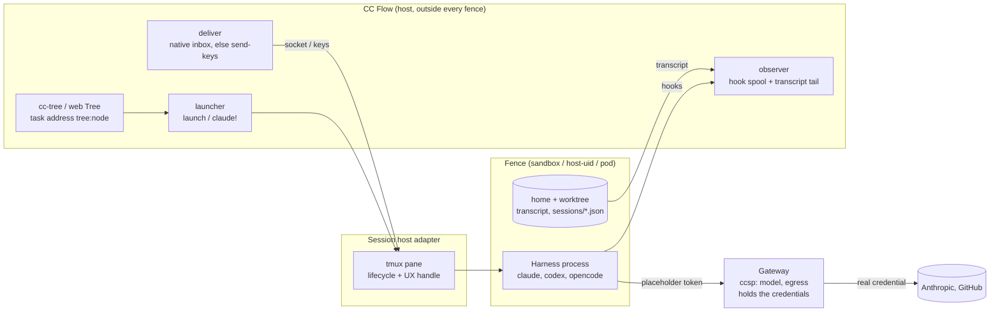

# Unified session model

> **Merged (2026-11-18):** areas A–E corrected parts of this doc. The current picture, conflicts and
> build list are in [unified-model.md](unified-model.md); the notes below mark what was superseded.

**In one line.** The k8s doc says *where* a session runs and what fences it. The harness doc
says *how* CC Flow drives it. They meet at one object, the **session**: a task address
(`<tree>:<node>`) that has one **host** (where it runs) and one **harness adapter** (how it is
driven). On this machine, a docker sandbox started as the process of an ordinary cc-tree tmux
pane reaches Claude Code's prompt in **0.45 s median (cold container)**, against **0.28 s** for
a plain start. The sandbox costs about 0.17 s, which is nothing next to today's 1.9 s
launch-to-brief path.

## 1. The model

Two independent axes, one session record:

| Axis | Question | Backends (tier order) | Owner doc |
|---|---|---|---|
| **Session host** | where the process runs, what fences it, who holds the credentials | `local` (tmux pane, today) → `sandbox` (a container as the pane's process, this doc) → `host-uid` (doc 68 rung 0b) → `pod` (after G1) | doc 68 |
| **Harness adapter** | how CC Flow spawns, sends to, observes, interrupts and approves the session | `claude` (hooks + transcript + native inbox / send-keys) → `codex`, `opencode` later | harness doc |



Rules that hold on every host:

1. **The address is the identity.** `<tree>:<node>` exists before any process. Harness session
   ids are stored as given and mapped to it (the two docs agree).
2. **The tmux pane is the handle on every host.** On `local` and `sandbox` it *is* the session's
   terminal; on `pod` it holds `ccattach`. cc-tree's ~150 `tmux()` calls (options, colours,
   capture, send-keys) keep working unchanged on the first two hosts, because the pane stays a
   host pane.
3. **Credentials live only in the gateway.** The fence gets placeholders. The host-side pieces
   (launcher, observer, deliver) sit outside the fence and are never reachable from inside it.
4. **Observation goes one way**: hooks write to a spool the host reads, and the transcript is read
   from the mounted home. Nothing inside the fence calls into tmux or the tree.

> *Superseded in part:* rule 3 now reads "upstream credentials only in ccsp-model and ccsp-egress; the MCP
> door holds none" and the rules grew to 12 (unified-model.md §1).

### The seam, corrected

Doc 68/69 name `cc_tree.py`'s single `tmux()` function as the seam. That holds for **pods**, where
the pane is remote. For the first sandbox the seam is narrower and one level up: **the command
the pane runs.** `launch()` (`bin/lib/cc_tree.py:4892`) builds `run_cmd = zsh -ic "claude! -N <ref> …"`
and hands it to `tmux new-window` / `respawn-pane`. `claude!` (`zsh/cc-flow.zsh:34`) does
everything host-side (bind the tab, name, colour, model pin) and ends in **one line**:
`cc-rc claude …` / `command claude …`. Swap that last line for `ccsbx run --node <ref> -- …` and
the session runs fenced, while every other part of CC Flow sees an ordinary tab.

So the session-host adapter has two layers:

| Op | `local` | `sandbox` | `pod` |
|---|---|---|---|
| spawn | `claude …` in the pane | `ccsbx run … -- claude …` in the pane | launcher creates the pod; pane runs `ccattach` |
| tmux ops (`tmux()`) | local tmux | local tmux (unchanged) | local tmux for the console pane; inner tmux via exec |
| send | native inbox socket, else send-keys | send-keys (verified); native socket once `/tmp/cc-socks` is mounted out | sidecar delivery |
| observe | hooks → `sb-hook`/cc-events; transcript in `~/.claude` | hooks → spool file in a mount; transcript in the mounted home | sidecar spool |
| stop | `/exit`, pane dies | `/exit`, the container leaves with `--rm`, the home volume stays | drain protocol |

> *Superseded:* the sandbox `send` row. Host↔container sockets don't connect (cooperation.md K2), so an in-fence relay
> posts to the container's own socket (unified-model.md §4 rows 3 and 34, build U22).

## 2. Where the two docs conflict, and a recommendation for each

| # | Harness doc says | k8s doc says | Recommendation |
|---|---|---|---|
| C1 | **tmux owns the lifecycle; never terminate/resume** a session to change it; background processes survive | pods **stop after 2 idle hours and resume from the transcript**; restarts become routine (patching, image bumps) | Both hold, per tier. On `local`/`sandbox` the pane owns the lifecycle and nothing stops a session but `/exit` (the container lives exactly as long as the pane). On `pod`, restart is the **platform's**, only at a turn boundary through the drain protocol, never to change a session. Reword the invariant to say "only the host's owner ends a session; a pod host may stop one only through drain". ❓ 1 |
| C2 | tmux **hosts** sessions; one named pane per session | an **inner tmux in the pod**, the Mac's tmux as a console, `ccattach` through kubectl exec | One tmux, outside the fence, until pods. The sandbox needs no tmux inside it (measured: `docker run -it` as the pane's process is enough). Inner tmux arrives only with pods, hidden behind `ccattach`. |
| C3 | input = a **Channel server** per session (research preview), send-keys as fallback | input = the **sidecar** delivering a native inbox frame between turns, from a hub with signed envelopes | Same job at different tiers. Tier 1 (sandbox): send-keys works through the pty as is; next, mount `/tmp/cc-socks` (where Claude Code puts its native inbox socket, seen in the spike) so the bus's existing `SessionBus.Native` can reach it. The Channel server and the sidecar are the pod-tier versions of the same last hop; don't build Channels before pods. |
| C4 | **scrub API-key env** so a subscription session never silently switches to billed API | a **gateway-held Console key** for unattended roles (billed API on purpose); interactive on the Max login (option A) | Rewrite the invariant: *the launcher chooses each session's billing mode and records it; no session switches mode silently*. The scrub stays for `local`; `sandbox`/`pod` get a placeholder and the gateway decides. |
| C5 | "the manager **never stores harness login tokens**, only spawns official binaries" | the only documented way to keep the Max login behind a gateway is the **token inside the client** (option A, MR-04/45) | Unresolved by design (Anthropic's). For a sandbox: a Console key at the gateway (option B) is the only setup with no real secret inside. ❓ 2 |
| C6 | **no session depends on the backend**; offline local starts | tree service moves **off hp** and splits; sessions talk only to session-api | Aligned in principle (doc 68 itself requires "sessions never depend on the tree service"). Keep `local` and `sandbox` as the offline modes; the sandbox needs only docker. |
| C7 | hooks → **local endpoint**, fail-open | hooks → **sidecar**; the agent cannot reach the endpoint unauthenticated | A spool file in a mounted directory is both: no listener for the agent to attack, the host tails it, it fails open. Use it on `sandbox`; the sidecar is that file's reader on `pod`. |
| C8 | Agent View / `--bg` competes for lifecycle; reject | not used | Agree. `ccsbx run` never passes `--bg`; one container per pane makes a supervisor pointless. |
| C9 | Remote Control: not useful | Remote Control gone (`disableRemoteControl`) | Agree; the sandbox's managed settings set it, and `claude!` skips `cc-rc` for sandbox starts. |

Doc 68 rung 0b's **host Unix user per agent** vs this doc's **docker container per session**:
on hp the user pool needs root (useradd, root-owned settings, nftables), while docker is already
there and gives the same fence without any of it: another uid, read-only rootfs, cap-drop, an
`--internal` network whose only member is the gateway. The cost is a shared kernel under runc,
so gVisor remains the upgrade. Recommendation: make the container the rung-0b backend on hp
and keep host users for the Mac, where docker means a VM. ❓ 3

## 3. Build list for the first test: one sandboxed agent launched from cc-tree, on hp only

Order matters; each step is useful alone. ✅ = exists today.

| # | Piece | Size | Works when | State |
|---|---|---|---|---|
| 0 | tmux tab per task, `launch()` → `claude!` | — | — | ✅ |
| 0 | docker on hp, an image with glibc, Claude Code binary from the host bind-mounted read-only | — | — | ✅ (spike: `python:3.12-slim` + `~/.local/share/claude/versions/2.1.327`) |
| 0 | fence + pre-seeded `~/.claude.json` (onboarding, trust, bypass prompt) so the start goes straight to the prompt | — | — | ✅ spike `spike/bench.py` (the keys doc 68 §6.1 marked unknown are now known) |
| 1 | **`ccsbx run`**: a real launcher, not a bench: `--node`, `--workdir` (the worktree mounted at its **same absolute path**, because resume is keyed by cwd), a **per-node home volume** (transcripts survive `--rm`), a read-only **managed-settings.json** baked in (base URL pin to the gateway, `disableRemoteControl`, auto-update off, the bypass prompt pre-accepted), placeholders only, `--help` with every tunable | S | in a tmux pane, `ccsbx run --node ai-tooling:x -- claude` lands at the prompt; `docker inspect` shows no host env and no secret; `/exit` leaves no container | — |
| 2 | **host switch in `claude!`**: a node field `Host: sandbox` (beside `Model:`, #344y) or `CC_FLOW_HOST=sandbox`; the last line execs `ccsbx run` instead of `cc-rc claude`; RC off | XS | Enter on a node with `Host: sandbox` opens a tab titled and bound as today, with Claude in the container (`docker ps` shows `ccsbx-<node>`) | — |
| 3 | **hook bridge**: hooks in the image append JSON lines to `/run/ccf/events.jsonl` (a host dir); a host tailer replays them as today's tmux hooks for that pane (purple/yellow, `@claude_id`) and as cc-events lines | S | the tab colours follow the session; `cc-events` gets launch → SessionStart → Stop for the sandboxed node | — |
| 4 | **send**: send-keys into the pane | — | a manager's message typed into the tab is answered | ✅ verified in the spike |
| 4b | native inbox: mount `/tmp/cc-socks` and the home's `sessions/` out; teach `SessionBus.Native` the container's `pidDomain` | S | `ccmsg <bus-id>` arrives as a native frame, not keystrokes | — |
| 5 | **model path with no secret inside**: a gateway container on the internal network plus the default bridge, forwarding to `api.anthropic.com` and adding the credential (ccsp today redacts only, it does not inject) | S | a real `say hi` gets an answer; a grep of the container's env, home and `/proc` finds no token | blocked on ❓ 2; until then the stub (✅) |
| 6 | **egress**: none. `--internal` network, the work stays in the mounted worktree; the host commits and pushes | — | `curl https://example.com` fails inside | ✅ (spike network) |
| 7 | **resume**: `claude! -N <ref> -r <sid>` into the same home volume and cwd | XS | a fresh-started sandbox session resumes its transcript | — |

> *Superseded:* item 4b won't work (cooperation.md K2: host↔container sockets don't connect; the live path is
> `/run/user/<uid>/cc-socks`). Replaced by C4, the in-fence relay (unified-model.md U22). Item 3's single `/run/ccf` mount is split
> into `out/` (rw) and `in/` (ro), and items 1–7 are folded into U1–U7 there.

**Minimum for "launch one sandboxed agent from cc-tree"**: 1 + 2 (S + XS), using the stub or a
real credential. With 3 it looks like any other tab. With 5 it does real work.
Not needed for the first test: gVisor, host users, k8s, the tree-service split, Channels.

## 4. Spin-up time, measured

**What the sandbox was** (hp-ubuntu, 2026-11-18, docker 29.9.2 rootful, runc, cgroup v2,
kernel 6.8, default seccomp + AppArmor): image `python:3.12-slim` (177 MB, cached locally);
the host's Claude Code 2.1.327 binary bind-mounted read-only; `--user 10001:10001 --read-only
--cap-drop ALL --security-opt no-new-privileges --pids-limit 512 --memory 2g`, tmpfs `/tmp`;
`--network ccsbx-net` (`--internal`: no internet, no host); its only peer is a stub model
(`spike/stub.py`) that answers "STUB-OK"; `ANTHROPIC_AUTH_TOKEN=ccflow-placeholder`.
**No real credential was inside**; the real arm used Tomas's login on the host and never sent a
prompt (0 tokens).

**Method** (`spike/bench.py`, raw data `spike/results/2026-11-18-hp.jsonl`): each start is a new
window in a private tmux server, as a cc-tree tab is. t0 = just before `tmux new-window`;
**ready** = the screen shows the empty prompt line and the mode line (capture-pane every 30 ms);
**answer** = `say hi` + Enter typed at ready (+0.3 s pause, excluded) until "● STUB-OK" is drawn.
Runs at `--settle 0` show typing at the first ready frame is not lost. 15 interleaved rounds of
4 arms; load average about 0.8 on 14 cores.

| Arm | What | ready p50 | min–max | first answer p50 | min–max |
|---|---|---|---|---|---|
| real | host, real login and network, user settings (hooks, plugins) skipped | **0.28 s** | 0.28–0.32 | — | — |
| host | host, the sandbox's env and home | 0.28 s | 0.27–0.31 | — ¹ | — |
| warm | `docker exec` into a running sandbox (warm pool) | 0.28 s | 0.28–0.34 | 0.39 s | 0.39–0.45 |
| **sbx** | **cold sandbox: `docker run` per start** | **0.45 s** | 0.41–0.48 | **0.55 s** | 0.52–0.59 |

¹ hp's root-owned managed settings pin `ANTHROPIC_BASE_URL` to ccsp, so no host process can reach
the stub (the placeholder got a 401 from Anthropic). That is ccsp's pin working, and also why a
container needs its own managed settings: **host managed settings don't reach into the sandbox**.

**Today's real end-to-end** (`~/.local/state/cc-events/hp-ubuntu.jsonl`, last 30 days, all
cc-tree starts): launch → SessionStart **1.56 s** median (p10 1.16, p90 2.56, n=1082);
launch → brief prompt submitted **1.93 s** (p10 1.38, p90 3.59, n=1019).

**Reading.** The container costs **+0.17 s** cold and **0** warm. The harness itself is about
0.3 s; most of today's 1.9 s is `claude!`, `cc-rc`, the bind and six SessionStart hooks
(inferred from the gap; not broken down here). A sandboxed start through `claude!` should land
around 2.1 s, about 9 % slower; a warm pool isn't worth building for speed.
Idle memory per sandboxed Claude Code: about 195 MB RSS.

**Not measured.** gVisor (`runsc` isn't installed; installing it needs root, ❓ 4). Published
figures put it at a few hundred ms more per start and a tax on syscall-heavy tools (git, npm,
rspec), which doc 68's S3 spike is for. Also not measured: a first image pull (once per image),
and the real model's latency, which is the same inside and outside the fence once a gateway
exists.

## 5. Decisions for Tomas

The ❓ nodes are listed under ai-tooling:#4yc5:

1. Lifecycle invariant (C1): reword it to "only the host's owner ends a session; pods only through
   drain". Rec: yes.
2. Model credential for a sandbox that does real work (C5): a Console API key with a hard monthly
   cap, held only by a gateway container, with a placeholder inside (rec). Or a `claude setup-token`
   token inside the container as a named Rule #1 exception. Or stay on the stub.
3. Docker container per session as the rung-0b backend on hp, instead of a pool of host users.
   Rec: yes.
4. Install gVisor on hp: root needed for the binary, a `runtimes` entry in `/etc/docker/daemon.json`
   and a docker reload (runtimes reload on SIGHUP; verify no container restarts). Rec: yes, as a
   measured step after build items 1–2.

## 6. Reproduce

```
cd ~/git/cc-sandbox/spike
./bench.py setup
./bench.py run real,sbx,warm,host -n 15 > results/<date>-<host>.jsonl
./bench.py summary results/<date>-<host>.jsonl
./bench.py teardown        # every ccsbx-* container, the network, the stub, .state/
```
